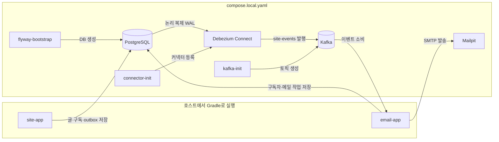

# 개발 메모

## 구성

| 구성 | 역할 |
|---|---|
| `site-app` | Thymeleaf 화면, 글 발행, 구독 신청·확정, outbox 기록 |
| PostgreSQL `neoguri95_site` | 글·구독·outbox 원본 데이터 |
| Debezium Connect | PostgreSQL `site_outbox_pub`의 INSERT를 CDC로 읽어 Kafka에 발행 |
| Kafka `site-events` | 구독 및 글 발행 이벤트 전달 |
| `email-app` / `neoguri95_email` | 구독자 투영, 이메일 발송 작업, 중복 처리 기록 |
| Mailpit | 로컬 SMTP와 메일 확인 화면 |

`site-app`의 `SubscriptionService`는 구독 신청·확정·해지를, `PostService`는 글 발행을 처리한다. 두 서비스는 각자의 DB 변경과 outbox 이벤트 기록을 한 트랜잭션으로 처리한다. Outbox의 `subject_type`은 `Subscription` 또는 `Post`이며 `subject_id`에는 해당 레코드 ID를 기록한다. Debezium은 두 종류의 이벤트를 `site-events` 토픽으로 전달한다. 이 토픽은 단일 파티션으로 운영해 구독 상태 변경과 글 발행의 순서를 유지한다. `email-app`은 구독 완료·해지 이벤트로 자체 구독자 목록을 갱신하고, 글 발행 이벤트에서 발송 작업을 생성한다. 작업자는 SMTP 발송 실패 시 재시도한다.

## 글쓰기 에디터

`/write`는 Tiptap 에디터를 쓴다. 소스는 `site-app/frontend`에 있고, Gradle `processResources`가 Vite 번들(`static/js/editor.js`)을 만들어 포함한다. 빌드하려면 Node.js와 npm이 PATH에 있어야 한다.

- 에디터는 HTML(`bodyHtml`)과 원본 문서 JSON(`bodyJson`)을 함께 제출한다.
- `PostContent`가 jsoup 허용 목록으로 HTML을 정제한다. `posts`에는 평문(`body`), 정제된 HTML(`body_html`), 에디터 원본(`body_json`)을 함께 저장한다.
- 글 화면은 `body_html`을 그대로 출력한다. 에디터 도입 전 글처럼 `body_html`이 없으면 `body`를 평문으로 출력한다.
- 본문 이미지는 `POST /admin/images`(`X-Admin-Token` 헤더 필요)로 올린다. PNG·JPG·GIF·WEBP를 장당 10MB까지 받고 `site.upload-dir`(`SITE_UPLOAD_DIR`, 기본값 `data/uploads`)에 저장해 `/uploads/**`로 제공한다. 운영에서는 이 경로를 영속 볼륨에 둔다.
- 작성 중인 글은 브라우저 `localStorage`에 임시저장되고, 발행하면 지운다.

## 로컬 Compose 흐름



`flyway-bootstrap`, `kafka-init`, `connector-init`은 초기화 후 종료하는 일회성 작업이다. `site-app`과 `email-app`은 Compose 서비스가 아니며 호스트에서 `bootRun`으로 실행한다. 앱별 Flyway 마이그레이션은 각 앱이 시작할 때 실행된다.

## 로컬 실행

```bash
docker compose -f compose.local.yaml stop connect
docker compose -f compose.local.yaml up -d --wait postgres kafka mailpit
docker compose -f compose.local.yaml run --rm flyway-bootstrap
docker compose -f compose.local.yaml run --rm kafka-init
SPRING_PROFILES_ACTIVE=local ./gradlew :site-app:bootRun
```

별도 터미널에서:

```bash
docker compose -f compose.local.yaml up -d connect
docker compose -f compose.local.yaml run --rm connector-init
SPRING_PROFILES_ACTIVE=local ./gradlew :email-app:bootRun
```

홈은 `http://localhost:8080`, 로컬 이메일은 `http://localhost:8025`에서 확인한다. 글 발행 예시:

```bash
curl -i -X POST http://localhost:8080/admin/posts \
  -H 'X-Admin-Token: local-admin-token' -H 'Content-Type: application/json' \
  -d '{"title":"첫 글","body":"안녕하세요."}'
```

`body`는 평문으로 받아 문단으로 변환한다. HTML 본문은 `bodyHtml`로 보내며, 이 값도 같은 방식으로 정제한다.
